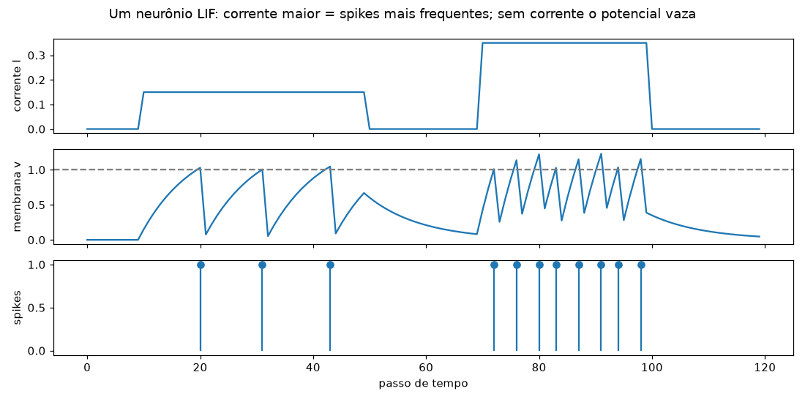
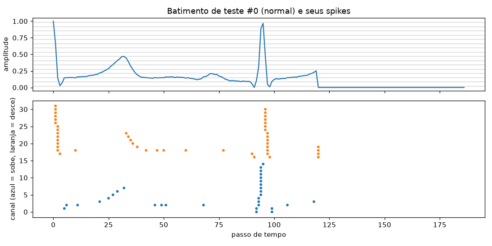
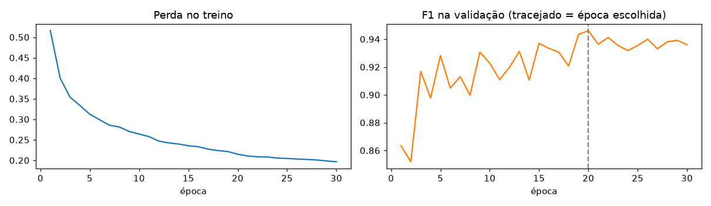
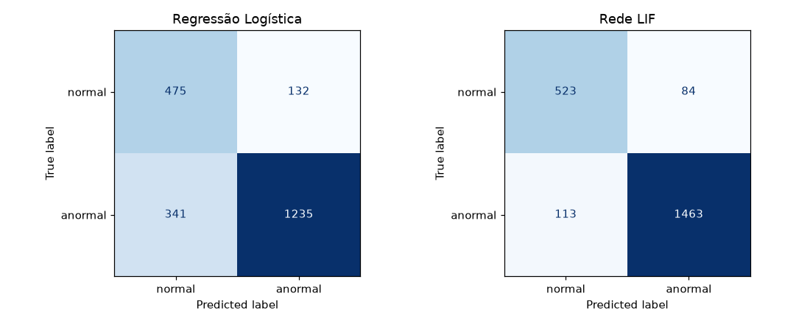

# CardioIA: Regressão Logística x Rede Neuromórfica LIF em ECG (Fase 3, Ir Além 2)

Compara um classificador tradicional (**regressão logística**) com uma rede de neurônios **Leaky Integrate-and-Fire (LIF)**, que trabalha com pulsos como um chip neuromórfico, na tarefa de classificar batimentos de ECG em **normal** ou **anormal**. A rede LIF foi escrita só com NumPy, incluindo o treino.

## 👨‍🎓 Integrante

- Pedro Gustavo França Moreira (RM: 568262)

## 👩‍🏫 Professores

- Tutor(a): Sabrina Otoni
- Coordenador(a): André Godoi

## 🎥 Vídeo de demonstração

**Link (YouTube, não listado):** COLAR_LINK_VIDEO

## 📄 Relatório

[relatorio_comparativo.md](relatorio_comparativo.md)

## 📊 Dataset

PTB Diagnostic ECG Database, parte do [ECG Heartbeat Categorization Dataset](https://www.kaggle.com/datasets/shayanfazeli/heartbeat). É a mesma base do Ir Além 2 da Fase 2.

- `ptbdb_normal.csv`: 4.046 batimentos normais
- `ptbdb_abnormal.csv`: 10.506 batimentos anormais
- Cada linha = 1 batimento com 187 amostras (normalizadas de 0 a 1) + rótulo

Como o Kaggle costuma ser bloqueado, o notebook baixa os CSVs sozinho de um espelho no GitHub:
`https://media.githubusercontent.com/media/chrmei/heartbeat_classification/main/data/original/`

Os CSVs não vão para o repositório (estão no `.gitignore`).

## 🧠 Pipeline

1. **Divisão:** 70% treino, 15% validação, 15% teste, estratificado (semente 42, igual à Fase 2).
2. **Regressão logística:** `StandardScaler` + `LogisticRegression` com `class_weight="balanced"` sobre os 187 valores do sinal.
3. **Sinal em spikes:** codificação por cruzamento de nível. 16 níveis de amplitude, cada um com um canal "sobe" e um "desce" (32 canais). Sinal parado não gera evento.
4. **Rede LIF:** 32 canais → 64 neurônios LIF (cada um com seu próprio β, entre 0,85 e 0,98) → contagem de spikes em 8 janelas de tempo → saída linear com 2 classes.
5. **Treino da LIF:** gradiente substituto (o spike é um degrau, sem derivada útil) e retropropagação no tempo (BPTT), com Adam escrito à mão. 30 épocas, guardando os pesos da melhor época na validação.
6. **Controle:** a mesma regressão logística sobre as contagens de spikes de entrada, para separar o efeito da codificação do efeito do neurônio.
7. **Avaliação:** acurácia, recall e F1 da classe anormal, matriz de confusão, tempo, número de parâmetros e atividade de spikes.

## 📈 Resultados (base de teste: 2.183 batimentos, 1.576 anormais)

| | Regressão Logística | Rede LIF |
|---|---|---|
| Acurácia | 78,3% | 91,0% |
| Recall anormal | 78,4% (1.235 de 1.576) | 92,8% (1.463 de 1.576) |
| Precisão anormal | 90,3% | 94,6% |
| F1 anormal | 0,839 | 0,937 |
| Parâmetros treináveis | 188 | 3.138 |
| Tempo de treino | 0,4 a 0,7 s | 47 a 65 s |
| Inferência (1000 batimentos, CPU) | 0,8 a 1,7 ms | 101 a 155 ms |

As métricas são idênticas a cada execução (semente fixa). Os tempos variam com a carga do computador, por isso aparecem como faixa. Os valores exatos de cada execução ficam em `resultados/metricas.json`.

**Controle:** a regressão logística sobre os spikes de entrada chegou a 81,4% de acurácia. A codificação ajuda um pouco, mas a maior parte do ganho vem da dinâmica dos neurônios LIF.

**Custo:** a LIF simulada em CPU faz cerca de 420 mil operações por batimento, contra 562 da logística. Só 1,3% das posições de entrada têm evento e 11,1% dos neurônios ocultos disparam por passo. Contando só os eventos, como faria um chip neuromórfico, a estimativa cai para cerca de 19,5 mil operações.









## 🔧 Como executar

```bash
pip install -r requirements.txt
jupyter notebook lif_vs_logistica.ipynb
```

Use *Kernel > Restart & Run All*. Roda em CPU, sem TensorFlow, em 1 a 2 minutos (a execução completa levou 1min31s aqui). Na primeira execução o notebook baixa os dois CSVs para a pasta `data/`.

## ⚠️ Limitações

- O PTB vem em batimentos soltos, sem identificador do paciente. Batimentos da mesma pessoa podem estar no treino e no teste, o que deixa os resultados otimistas.
- Uma única divisão e uma única semente, sem validação cruzada.
- Poucas configurações da LIF testadas na validação.
- A rede LIF é simulada em CPU (arquitetura Von Neumann). A vantagem de energia de uma SNN só aparece em hardware neuromórfico; a contagem de eventos é uma estimativa, não uma medição.
- Projeto acadêmico, não usar para diagnóstico.
